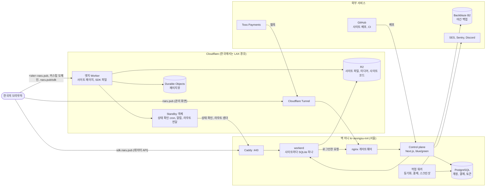
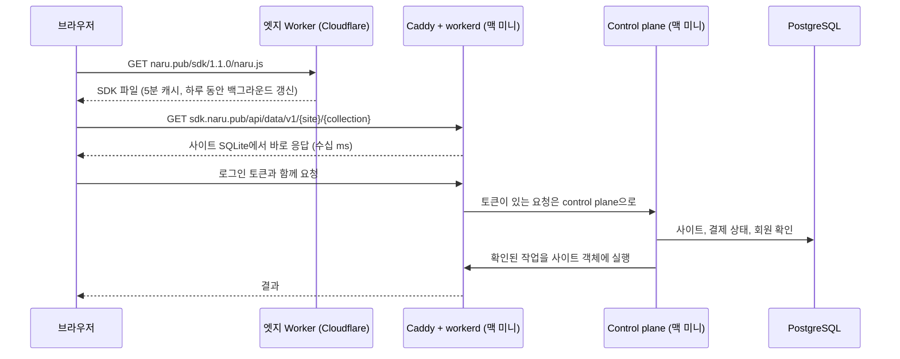

# 나루 (Naru)

> 당신의 공간을 나루에 띄워 보세요.

나루는 개인 웹사이트 호스팅 플랫폼으로, 누구나 자신만의 갠홈페이지를 만들고 관리할 수 있게 해주는 서비스입니다.

## 🚀 주요 기능

- **개인 웹사이트 호스팅**: 사용자별 서브도메인을 통한 개인 웹사이트 제공
- **파일 관리**: 웹 기반 파일 브라우저를 통한 파일 업로드, 편집, 삭제
- **실시간 편집**: CodeMirror 기반의 실시간 코드 편집기
- **다양한 파일 형식 지원**: HTML, CSS, JavaScript, JSON, Markdown 등
- **사용자 인증**: Lucia Auth를 통한 안전한 사용자 인증 시스템
- **통계 대시보드**: 서비스 사용 현황 및 지표 모니터링
- **커스텀 도메인**: 유료 이용자 도메인을 Cloudflare for SaaS로 받아 엣지 Worker에서 서빙
- **결제(결제)**: Toss Payments 자동결제로 운영을 지탱하는 결제 모델

## 🏗️ 아키텍처

나루는 세 부분으로 이루어져 있습니다. 서울의 맥 미니(kr-seongsu-m4)에서 도는 control plane과 사이트 데이터베이스, 그리고 Cloudflare의 엣지 Worker입니다. 한국에서 Cloudflare로 가는 요청은 로스앤젤레스를 거치므로, 매 요청이 빨라야 하는 Data SDK는 `sdk.naru.pub`으로 맥 미니에 바로 연결합니다.

### 1. Control Plane (Next.js)

- **위치**: `control-plane/`
- **기술 스택**: Next.js, React, TypeScript, Tailwind CSS
- **주요 기능**:
  - 사용자 인증 및 계정 관리
  - 웹 기반 파일 브라우저
  - 실시간 코드 편집기
  - 관리자 대시보드

### 2. Edge Worker (Cloudflare)

- **위치**: `edge/`
- **기술 스택**: Cloudflare Workers, R2, Durable Objects, TypeScript
- **주요 기능**:
  - 서브도메인(`<login>.naru.pub`)과 커스텀 도메인 사이트를 R2에서 바로 서빙
  - 맥 미니 상태 확인: 매분 확인해 멈추거나 되살아나면 Discord로 알림 (장애 전환은 하지 않음)
  - 페이지뷰 기록(control plane이 매분 가져가 저장)

### 3. 사이트 데이터베이스와 Data SDK (맥 미니, `sdk.naru.pub`)

- **위치**: `edge/src/seoul.ts`, `edge/seoul/` (같은 Worker 코드를 workerd로 실행)
- **주요 기능**:
  - 사이트마다 SQLite 데이터베이스 하나(`SiteData`)
  - 데이터 API, 사이트 코드(쿼리, 뮤테이션, 라우트)와 사이트 테이블, 실시간 쿼리
  - 한국에서 한 번 왕복에 수십 ms (Cloudflare 경유 때는 약 1초)

### Data SDK 요청이 지나는 길

방문자의 읽기는 맥 미니의 workerd가 바로 답합니다. 로그인한 요청은 workerd가 같은 호스트의 control plane에 넘겨 PostgreSQL로 권한을 확인한 뒤, 다시 workerd의 사이트 데이터베이스에서 처리합니다. `naru.js` 파일은 Cloudflare(`naru.pub/sdk/`)에서 받고, 브라우저가 하루 동안 보관합니다.

### 맥 미니가 멈추면

사이트 데이터베이스는 맥 미니에만 있습니다. 대기본은 없고, 맥 미니를 잃으면 B2의 야간 백업으로 복구합니다. 맥 미니가 멈춘 동안에는:

- 사이트의 정적 파일은 엣지 Worker가 R2에서 계속 서빙합니다.
- 데이터 호출은 실패합니다. SDK는 `UNAVAILABLE` 오류로 알립니다. control plane도 같은 맥 미니에 있어 로그인과 관리 화면도 멈춥니다.
- 라우트 경로로 들어온 페이지 이동에는 사이트의 `index.html`을 상태 503으로 돌려줍니다(`Cache-Control: no-store`, `Retry-After: 60`). 앱의 껍데기는 뜨고, 잠시 뒤에 다시 시도할 수 있습니다.
- 엣지 Worker의 cron이 매분 `origin.sdk.naru.pub`을 확인해, 3분 연속 응답이 없으면 Discord로 알리고, 다시 응답하면 한 번 더 알립니다.

자세한 내용은 [사이트 데이터베이스](docs/database.md#when-the-mini-is-away) 문서에 있습니다.

## 📚 문서

- [사이트 데이터베이스](docs/database.md) — JSON 문서 저장소, 공개/관리자 권한, 웹 SDK

- [개발 환경 설정](docs/development.md) — 설치, 환경 변수, 실행, 프로젝트 구조, 테스트, 스크립트
- [커스텀 도메인](docs/custom-domains.md) — Cloudflare for SaaS, 엣지 Worker 라우트, 인증 자동 폴링
- [유료 서비스와 결제](docs/billing.md) — 시간 기반 엔티틀먼트와 Toss Payments 자동결제
- [GitHub CI Deploys](docs/github-ci.md) — GitHub Actions OIDC 기반 배포 연동
- [기여하기](docs/contributing.md)

## 📄 라이선스

이 프로젝트는 [GNU Affero General Public License v3.0](LICENSE) 하에 배포됩니다.

## 📞 문의

- **트위터**: [@naru_pub](https://x.com/naru_pub)
- **이슈**: [GitHub Issues](https://github.com/your-username/naru-pub/issues)

## 🙏 감사의 말

나루는 다음과 같은 오픈소스 프로젝트들에 의존하고 있습니다:

- [Next.js](https://nextjs.org/) - React 프레임워크
- [Lucia Auth](https://lucia-auth.com/) - 인증 라이브러리
- [CodeMirror](https://codemirror.net/) - 코드 에디터
- [Tailwind CSS](https://tailwindcss.com/) - CSS 프레임워크
- [Kysely](https://kysely.dev/) - TypeScript SQL 쿼리 빌더

---

**즐거운 코딩 되세요! 🚀**
